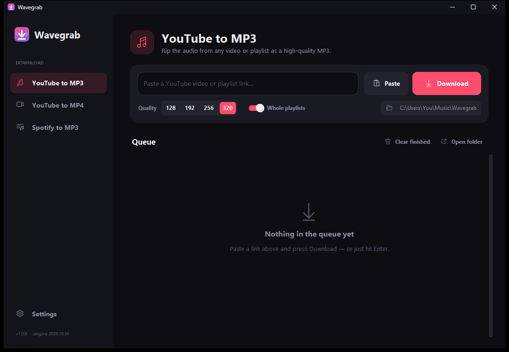
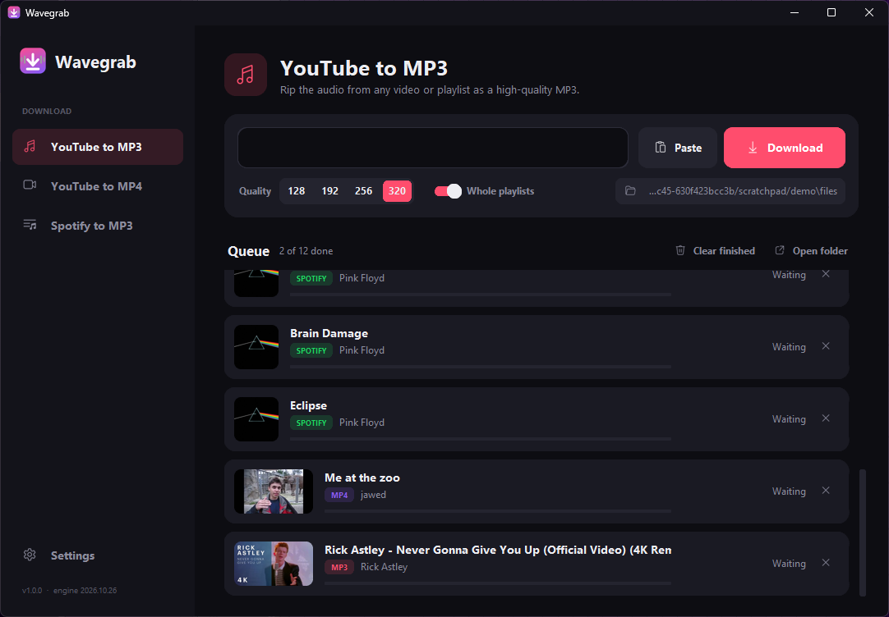

# Wavegrab

A clean little Windows app for saving music and videos:

- **YouTube → MP3**: single videos or whole playlists, 128–320 kbps
- **YouTube → MP4**: 480p, 720p, 1080p or best available (up to 4K), H.264 where possible so it plays anywhere
- **Spotify → MP3**: songs, albums and playlists. Spotify audio is copy-protected, so each track is matched to the same recording on YouTube (by title, artist and exact length) and tagged from Spotify.




## Proper song tags

Every MP3 that's a song gets full ID3v2.3 tags (the version Windows, phones and car stereos read best):

| Tag | Source |
| --- | --- |
| Title, artist | Spotify, or worked out from the YouTube video |
| Album, album artist, track no., disc no., genre | Spotify album / Apple iTunes catalogue |
| Release date | Spotify's release date, or the album's release date from iTunes, never the YouTube upload date |
| Cover art | Square album art: Spotify 640px, or iTunes 1000px |

Catalogue data is only used when title, artist **and** song length agree, so songs don't get mislabelled.
Songs recognised from YouTube are saved as `Artist - Title.mp3`. Non-music videos keep their title, channel and upload date.
MP4s get title, channel, date and the video thumbnail embedded.

## Install

Run `Wavegrab-Setup-x.y.z.exe`. It installs per-user (no admin prompt) and bundles everything it needs (ffmpeg, Deno).

If downloads ever start failing, open **Settings → Download engine → Update**: YouTube changes things often, and
this fetches the newest [yt-dlp](https://github.com/yt-dlp/yt-dlp) without reinstalling.

## Build from source

Needs Python 3.12+ and [Inno Setup 6](https://jrsoftware.org/isinfo.php) (`winget install JRSoftware.InnoSetup`).

```powershell
powershell -ExecutionPolicy Bypass -File build.ps1
```

That installs the Python deps, downloads ffmpeg + Deno into `vendor\`, builds `dist\Wavegrab\Wavegrab.exe`
with PyInstaller and packs `dist\Wavegrab-Setup-<version>.exe`.

Run from source: `python run.py`. Quick end-to-end check: `Wavegrab.exe --selftest <folder>`.

## Layout

```
run.py                 entry point (+ --selftest)
wavegrab/app.py        the UI (customtkinter)
wavegrab/engine.py     yt-dlp downloads, Spotify lookup, YouTube matching, engine updates
wavegrab/meta.py       song identification + ID3 tagging
tools/make_icon.py     draws the app icon
installer.iss          Inno Setup script
build.ps1              one-shot build
```

Only download content you have the right to.
